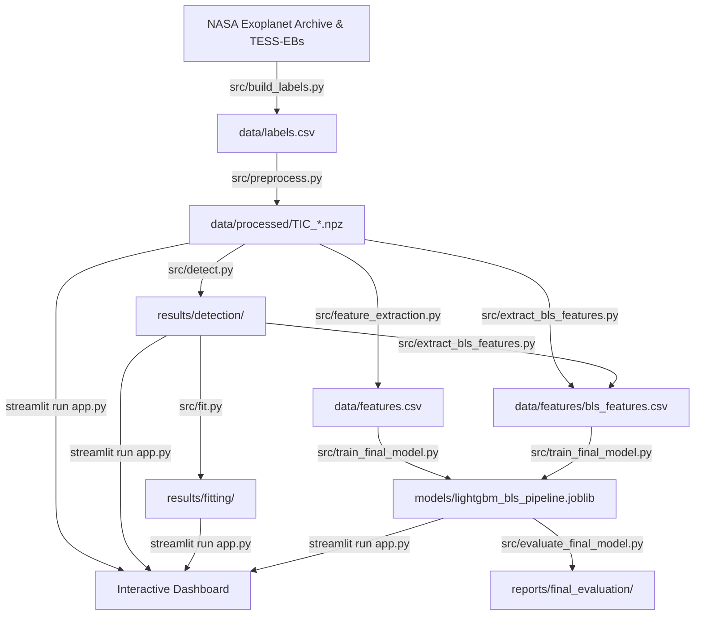

# Exoplanet Detection using Machine Learning (ExoScope)

This repository implements an end-to-end astronomical pipeline for detecting, vetting, modeling, and classifying exoplanet transit signals in high-precision **TESS** (Transiting Exoplanet Survey Satellite) light curves.

A light curve records a star's brightness over time. When an orbiting planet transits across the stellar disk, the observed brightness dips periodically. The pipeline automates the discovery of these periodic transit dips and applies machine learning to distinguish true planetary transits from astrophysical false positives (such as eclipsing binary stars) and stellar variability.

---

## Project Structure

```text
exoplanet-detection/
│
├── data/                             # Generated locally (gitignored)
│   ├── raw/                          # Temporary FITS downloads (cleaned automatically)
│   ├── processed/                    # Preprocessed 10-min binned light curves: TIC_<id>.npz
│   ├── full/                         # Full 2-min cadence light curves: processed_TIC_<id>.csv
│   ├── features/                     # Extracted BLS transit features: bls_features.csv
│   ├── features.csv                  # Extracted statistical light curve features
│   ├── labels.csv                    # Catalog: tic_id, label, source, split
│   ├── failed.csv                    # Diagnostic log of skipped/failed stars
│   └── preprocess.log                # Execution log of data acquisition and preprocessing
│
├── notebooks/
│   └── detection.ipynb               # Step-by-step BLS detection walkthrough on TIC 307210830
│
├── src/
│   ├── build_labels.py               # Downloads public catalogs & constructs data/labels.csv
│   ├── preprocess.py                 # Ingestion, validation, cleaning, detrending, and caching
│   ├── detect.py                     # BLS periodogram search, iterative masking, and vetting
│   ├── fit.py                        # Physical transit parameter fitting using batman
│   ├── feature_extraction.py         # Statistical & variability feature engineering
│   ├── extract_bls_features.py       # First-signal BLS feature extractor
│   ├── compare_models.py             # 5-fold CV comparison: Random Forest vs. LightGBM
│   ├── train_final_model.py          # Trains final production LightGBM + BLS classifier
│   ├── evaluate_final_model.py       # Evaluates model on held-out test split
│   ├── predict.py                    # Standalone CLI prediction on any processed target
│   └── dashboard_utils.py            # Artifact loaders & helpers for the Streamlit UI
│
├── tests/
│   └── test_preprocess.py            # Unit tests for preprocessing, caching, and validation
│
├── app.py                            # Interactive Streamlit dashboard
├── models/
│   └── lightgbm_bls_pipeline.joblib  # Trained LightGBM classification pipeline
├── results/
│   ├── detection/                    # Detection tables, periodograms, and fold plots
│   └── fitting/                      # Fitted physical transit parameters
├── reports/
│   ├── model_comparison/             # Cross-validation metrics and confusion matrices
│   └── final_evaluation/             # Test set evaluation predictions & feature importance
├── requirements.txt
└── README.md
```

---

## Setup & Installation

### 1. Clone the repository and enter the directory
```bash
git clone https://github.com/gargijoshi9/exoplanet-detection.git
cd exoplanet-detection
```

### 2. Create and activate a Python virtual environment
Python 3.10 to 3.13 is recommended.

```bash
python3 -m venv venv

# On macOS / Linux:
source venv/bin/activate

# On Windows (Command Prompt / PowerShell):
venv\Scripts\activate
```

### 3. Install dependencies
```bash
pip install --upgrade pip
pip install -r requirements.txt
```

---

## Complete Step-by-Step Running Instructions

Because raw telescope data and processed photometry are not versioned in git, follow these steps to build the dataset, extract features, train the model, and launch the interactive dashboard.



---

### Step 1: Build the Target Catalog (`src/build_labels.py`)

Fetches confirmed and candidate planets from the **NASA Exoplanet Archive (TOI catalog)** and eclipsing binary stars from the **Villanova TESS-EBs catalog**.

```bash
# Default: 50 target stars per class (with 1.6x oversampling = 240 candidates total)
python src/build_labels.py
```

* **Scaling up**: To build a larger catalog, use `--n-per-class` (e.g. `--n-per-class 100` generates 480 candidate stars).
* **Incremental preservation**: Re-running `build_labels.py` preserves 100% of previously generated stars and their assigned train/test splits.
* **Extended mission sectors**: By default, `--max-toi 2000` is applied to match Primary Mission Sectors 1–26. Pass `--max-toi 0` if you want candidate stars alerted in later sectors.

---

### Step 2: Download & Preprocess Light Curves (`src/preprocess.py`)

Downloads 2-minute cadence SPOC PDCSAP light curves from MAST via `lightkurve`, removes stellar variability with a Savitzky-Golay detrending filter, normalizes flux, and bins to 10-minute intervals.

```bash
# Standard batch run (downloads all candidates in parallel using 4 workers)
python src/preprocess.py --workers 4
```

#### Key Capabilities & Options:
* **Automatic Caching**: Any star that already has a valid `TIC_<id>.npz` file in `data/processed/` is **automatically validated and skipped**. It will not be re-downloaded or overwritten.
* **Resilient Failure Logging**: Permanently unavailable targets (no 2-min SPOC cadence or sector $> 26$) are recorded in `data/failed.csv` and automatically skipped on subsequent runs.
* **Pilot Test Mode**: Run on just 10 stars per class to quickly verify your pipeline:
  ```bash
  python src/preprocess.py --per-class 10 --workers 4
  ```
* **Unlock Extended Missions (Sectors $> 26$)**:
  ```bash
  python src/preprocess.py --max-sector 0 --retry-failed --workers 4
  ```
* **Single-Star Full Cadence (for high-resolution BLS / fitting)**:
  Downloads multiple sectors at full 2-minute cadence (unbinned) and saves a CSV:
  ```bash
  python src/preprocess.py --tic 307210830 --sectors 8 9 10 11 12 --full
  ```

---

### Step 3: Run Transit Detection (`src/detect.py`)

Executes a Box Least Squares (BLS) periodogram search with iterative signal masking to discover multi-planet candidates and evaluate automated vetting criteria.

```bash
# Run detection on a single processed target
python src/detect.py --npz data/processed/TIC_1129452.npz

# Or run detection on a full-cadence CSV
python src/detect.py --csv data/full/processed_TIC_307210830.csv
```

Outputs written to `results/detection/`:
* `<name>_detections.csv`: Summary table of detected period, duration, depth, SNR, SDE, and vetting status (`candidate`, `flagged`, `rejected`).
* `<name>_overview.png`: Entire light curve with marked transit ingress/egress.
* `<name>_periodogram_<n>.png`: BLS periodogram showing candidate spectral peaks.
* `<name>_fold_<n>.png`: Light curve folded on the detected orbital period.

---

### Step 4: Fit Physical Transit Parameters (`src/fit.py`)

Refines the detected transit using the physical **batman** (Bad-Ass Transit Model Calculation) analytical model with non-linear least squares optimization. It estimates the planet-to-star radius ratio ($R_p/R_*$), impact parameter ($b$), scaled semi-major axis ($a/R_*$), and mid-transit epoch ($T_0$).

```bash
python src/fit.py --tic 1129452
```

Outputs written to `results/fitting/TIC_<id>_fit_params.csv`.

---

### Step 5: Feature Extraction (`src/feature_extraction.py` & `src/extract_bls_features.py`)

Computes both statistical light curve features and first-signal BLS transit features across all processed light curves:

```bash
# 1. Statistical features (skewness, kurtosis, variance, robust amplitude, percentiles)
python src/feature_extraction.py

# 2. BLS transit features (period, depth, duration, SNR, SDE, odd-even symmetry)
python src/extract_bls_features.py
```

Outputs saved to:
* `data/features.csv`
* `data/features/bls_features.csv`

---

### Step 6: Train & Evaluate the Machine Learning Classifier

Train the production LightGBM classifier combining both statistical and transit features, followed by held-out test evaluation:

```bash
# 1. Train the classifier (saves to models/lightgbm_bls_pipeline.joblib)
python src/train_final_model.py

# 2. Evaluate performance on the held-out test split
python src/evaluate_final_model.py
```

Outputs saved to `reports/final_evaluation/`:
* `test_predictions.csv`: Actual vs. predicted labels for the test split.
* `feature_importance.csv`: Ranked importance of all engineered features.

To compare cross-validation performance between Random Forest and LightGBM:
```bash
python src/compare_models.py
```

---

### Step 7: Launch the Interactive Web Dashboard (`app.py`)

Launch the modern **ExoScope** Streamlit dashboard:

```bash
streamlit run app.py
```

Open the local browser URL (typically `http://localhost:8501`).

#### Dashboard Pages:
1. **Overview**: Dataset metrics, class breakdown, train/test distributions, and pipeline status.
2. **Analyze**: Interactive Plotly light curve explorer (zoom, pan, error bars), phase-folded views, periodograms, and live BLS / ML inference on any target.
3. **Parameter Fitting**: Physical transit modeling using `batman`, interactive overlay of best-fit transit model, residual analysis, and parameter export.
4. **Model Performance**: Cross-validation benchmark metrics, confusion matrices, precision/recall/F1 breakdowns, and feature importance rankings.

---

### Step 8: Run Automated Unit Tests

A comprehensive unit test suite is provided to verify observation selection, caching, validation, retry logic, and schema compatibility offline without requiring active MAST network calls:

```bash
python -m pytest tests/ -v
```

---

## Preprocessing Pipeline Architecture

Implemented in `src/preprocess.py`:

1. **Pre-Download Search & Filtering**:
   Queries TESS SPOC 120-second cadence metadata before requesting FITS payloads. Filters out missing or malformed sector headers.
2. **Deterministic Observation Selection**:
   Filters for observations within the configured era (`--max-sector 26` by default) and picks the earliest available sector deterministically.
3. **Array Validation**:
   Checks that the downloaded product contains valid, finite `pdcsap_flux` values.
4. **Outlier Rejection**:
   Applies asymmetric sigma-clipping ($5\sigma$ upper, $10\sigma$ lower) to reject instrument flares while preserving deep planetary transit dips.
5. **Detrending & Normalization**:
   Applies a Savitzky-Golay filter (window length 301 cadences, polynomial order 2) to remove low-frequency stellar activity.
6. **Cadence Binning**:
   Bins to 10-minute cadence for fast feature extraction in batch mode (`flux`), while preserving unflattened flux (`flux_norm`) for masked re-flattening during physical transit fitting.
7. **Atomic Write & Integrity Verification**:
   Saves to a temporary file, verifies that array dimensions match and values are finite, and atomically moves the archive into `data/processed/TIC_<id>.npz`.

---

## Scientific Background & Vetting Checks

During transit detection (`src/detect.py`), every candidate signal is subjected to astronomical vetting checks:

| Vetting Check | Threshold | Description |
|---|---|---|
| **Transit Multiplicity** | $\ge 2$ transits | Rejects single noise spikes and instrumental glitches. |
| **Odd/Even Consistency** | $< 3\sigma$ | Detects eclipsing binary stars (secondary eclipses create alternating depths). |
| **Secondary Eclipse Check** | $< 3\sigma$ | Checks for a secondary occultation dip at phase 0.5. |
| **Transit Depth Limit** | $< 50{,}000\text{ ppm}$ ($5\%$) | Stellar eclipses are typically far deeper than planetary transits. |
| **Duty Cycle Ratio** | Duration / Period $< 0.1$ | Excludes long-duration stellar variations that cannot be Keplerian transits. |
| **Red Noise SNR** | Reported (`snr_red`) | Accounts for correlated noise using the Allan variance of the out-of-transit flux. |

---

## Data Catalogs & Citations

* **TESS Photometry**: NASA Transiting Exoplanet Survey Satellite (SPOC 2-minute cadence data), accessed via [Lightkurve](https://docs.lightkurve.org/).
* **TOI Catalog**: NASA Exoplanet Archive TESS Objects of Interest (TOI) table (CP, KP, PC, FP, FA dispositions).
* **TESS-EBs Catalog**: Prša et al. 2022, *TESS Eclipsing Binary Stars. I. Short-cadence Observations of 4584 Eclipsing Binaries in Sectors 1 to 26*, ApJS 258, 16 ([VizieR J/ApJS/258/16](https://cdsarc.cds.unistra.fr/viz-bin/cat/J/ApJS/258/16)).
* **Transit Modeling**: `batman` analytical transit light curve model ([Kreidberg 2015](https://ui.adsabs.harvard.edu/abs/2015PASP..127.1161K/abstract)).